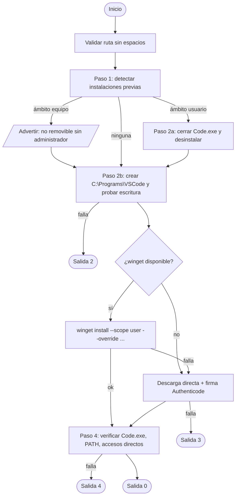

# Arquitectura y decisiones de diseño

## Diagrama de flujo

## Decisiones

| Decisión | Justificación |
|---|---|
| `--scope user` | Selecciona el instalador de usuario (equivalente al enlace `win64user`); no requiere elevación. |
| `--override` con argumentos de Inno Setup | `/DIR=` fija el destino y `/MERGETASKS=` habilita accesos directos, menú contextual, asociaciones y PATH. `--override` sustituye los argumentos por defecto, por lo que se incluye `/VERYSILENT`. |
| `!runcode` | Evita que VS Code se abra al terminar la instalación silenciosa. |
| Enlace `sha/download?...os=win32-x64-user` | La URL `thank-you?dv=win64user` es una página HTML; este enlace entrega el mismo instalador de usuario para el respaldo. |
| Validación Authenticode | El respaldo descarga un ejecutable; se exige firma válida de *Microsoft Corporation* antes de ejecutarlo. |
| Espera activa tras desinstalar | El desinstalador de Inno se relanza desde `%TEMP%`, por lo que el proceso original puede retornar antes de terminar. |
| Limpieza acotada | Solo se elimina la carpeta de destino del propio script, nunca una raíz de unidad. |
| CMD en ASCII | Evita corrupción por páginas de códigos en `cmd.exe`. El `.ps1` se guarda en UTF-8 con BOM para PowerShell 5.1. |
| `DisableDelayedExpansion` en CMD | El carácter `!` de `!runcode` debe conservarse literal. |

## Permisos de `C:\Programs`

Por defecto, en la raíz de la unidad del sistema los usuarios autenticados pueden **crear subcarpetas** y quedan como propietarios de las que crean. Por eso un usuario estándar suele poder crear `C:\Programs`. Las políticas corporativas pueden modificar esta ACL; en tal caso el script termina con código `2`.
